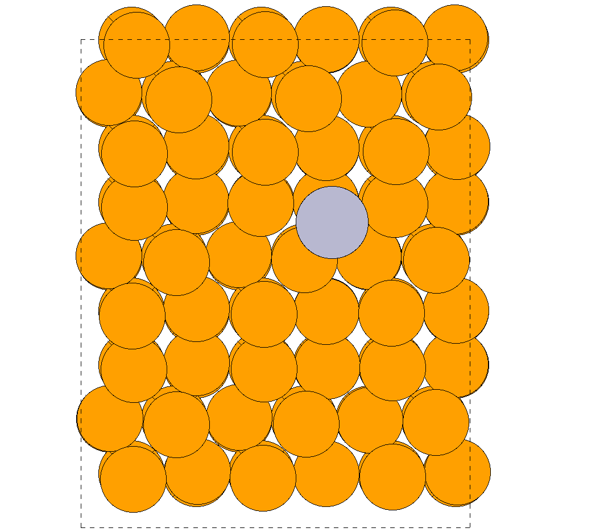
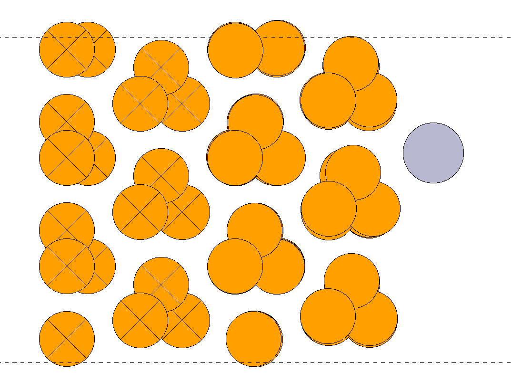

==================================================
Hg adsorption on selenium surfaces with MACE + ASE
==================================================

Why
---
Selenium is a detector surface in gas-phase thermochromatography of superheavy elements.
Hg is the lighter homologue of copernicium (Cn, Z = 112). The experiment
(N.V. Aksenov, N.M. Chiera et al., J. Radioanal. Nucl. Chem. 311 (2017) 99) gives :

- trigonal Se (t-Se)        : -dH_ads(Hg) < 60 kJ/mol
- red amorphous Se (a-Se)   : -dH_ads(Hg) > 85 kJ/mol

Question : can a universal machine-learned interatomic potential (MACE-MP-0 + D3), driven by ASE,
reproduce these numbers - and if not, why not ?

Software
--------
Linux (WSL2 Ubuntu works), Python 3, as in the BLTP JINR modelling school :

conda create -n molmatmodel ; conda activate molmatmodel

conda install -c conda-forge ase

pip install mace-torch torch-dftd

MACE-MP-0 medium, D3 dispersion via torch-dftd, float64, CPU only (2 cores, cca 2 s per energy
of a 109 atom system). All runs together take cca 1 hour.

Folders (run in this order)
---------------------------
=========================  =====================================================================
01_tSe_bulk                t-Se bulk, MACE-MP-0 vs MACE-MP-0+D3 against experiment
02_tSe_slab                t-Se(10-10) slab of whole chains, relaxed
03_Hg_on_tSe               6x6 site scan + full relaxation of Hg on t-Se
04_Hg_on_aSe_models        Hg on Se8 ring and on a chain-end defect (models of red a-Se)
05_thermochemistry         vibrations, ZPE, dH_ads(T), dS, dG - comparison with experiment
06_checks                  Hg-Se bond test (HgSe crystal), slab thickness
=========================  =====================================================================

Every folder has a readme.rst, the scripts, and the saved outputs (``*.py_logfileSAVED``,
``.traj``, ``.vasp`` for VESTA).

Structure
---------
Hg (grey-blue) adsorbed on the t-Se(10-10) surface (Se orange), MACE-MP-0+D3, relaxed.

Top view (left) and side view (right). Crossed atoms in the side view = fixed bottom chain layers.

Relaxation movie : 07_movies/Hg_on_tSe_relax.gif

Main results (298 K)
--------------------

================  ========  =========  ==================  ============================
Surface           -E_ads    -dH_ads    experiment -dH_ads  comment
                  (kJ/mol)  (kJ/mol)   (kJ/mol)
================  ========  =========  ==================  ============================
t-Se(10-10)       24.4      23.1       < 60                physisorption, d(Hg-Se) 3.67 A
Se8 ring          21.3      -          -                   physisorption
t-Se chain end    40.30      39       > 85 (red a-Se)     d(Hg-Se) 2.97 A, too weak
================  ========  =========  ==================  ============================

What I learned
--------------
1. D3 is necessary : without it the Se chains drift apart (+10 % inter-chain distance)
2. On t-Se, Hg is physisorbed in hollows between the chains, 24 kJ/mol - consistent with experiment
3. Under-coordinated Se (chain ends) binds Hg more strongly - the right TREND for amorphous Se ;
   the defect relaxes to the known valence-alternation pair of amorphous selenium
4. But the magnitude is too small (40 vs > 85 kJ/mol). The reason : MACE-MP-0 strongly underbinds
   the chemical Hg-Se bond (HgSe formation energy wrong by cca 240 kJ/mol, see 06_checks)
5. The thermal correction to the enthalpy is only cca +1.2 kJ/mol (= 1/2 kT, checked analytically) ;
   E_ads itself decides the comparison with experiment
6. ASE 3.29 IdealGasThermo needs the pressure in Pa explicitly, the default gives a wrong
   entropy (checked against NIST : S(Hg, 298 K) = 174.97 J/mol/K)

Next steps
----------
- Quantum ESPRESSO PBE-D3 reference for a few Hg/Se configurations (HgSe bulk, Hg on t-Se,
  Hg at the chain end) - is it the MLIP or the DFT level ?
- fine-tune MACE on these DFT energies/forces (rattled structures and short MD, not only
  relaxation frames), then repeat 03-05
- bigger amorphous Se model (melt-quench MD with the fine-tuned potential), many sites
- the same workflow for Cn and Fl on Se (spin-orbit coupling becomes important)

Author
------
<Swastik Bhandari>, <Kathmandu University>, <swastik3223@student.ku.edu.np>
